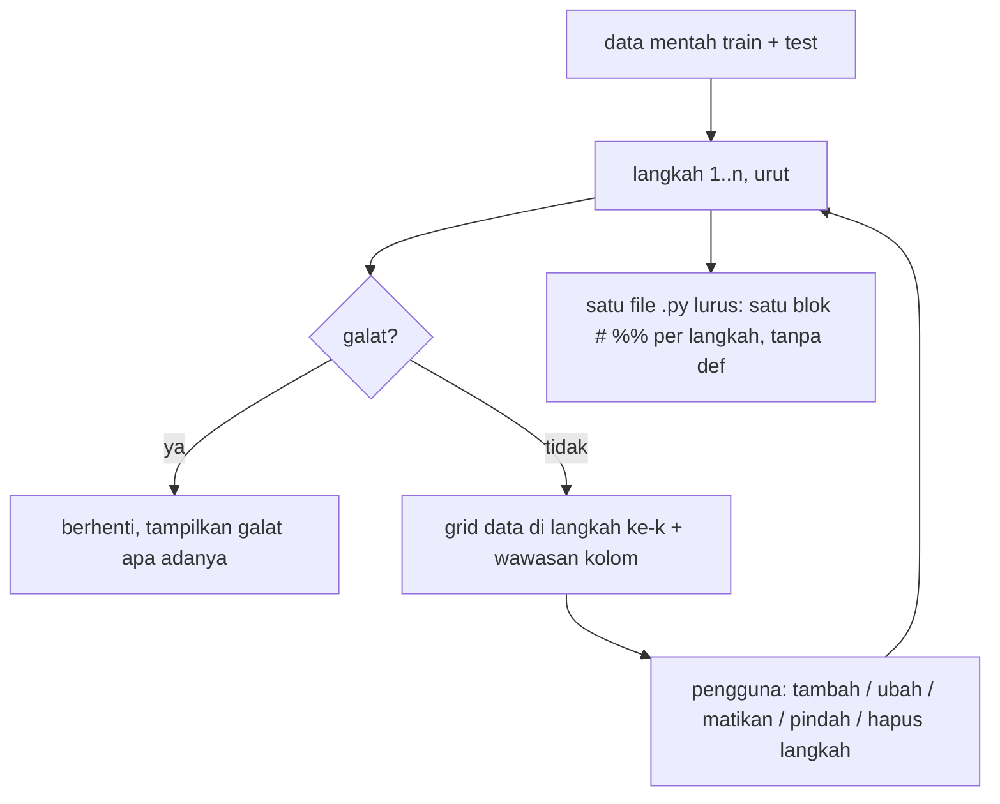

# Status kerja Laya EDA v2

Tujuan, requirement, prinsip, library, dan uji terima ada di [`VISI.md`](VISI.md) (satu-satunya
sumber). File ini hanya: status, arsitektur yang sudah jalan, dan hasil uji di data riil. Rencana v2 lama
(tujuan, prinsip P1–P7, flowchart per tab, checklist, keputusan terbuka) dihapus 2026-11-02; isi yang masih
berlaku dipindah ke VISI.md, versi lama ada di `git show 9cf8474:_laya_eda_v2/RENCANA.md`.

## STATUS 02-11-2026 — baca ini dulu (lanjutan di sesi cloud)

**Aturan tetap (jangan dilanggar):** requirement R1–R18 di `VISI.md` bagian 1.

**Masalah utama yang sedang dikerjakan:** kode EDA terlalu hardcoded saat memperbaiki typo/ejaan atau drop.
Sesi pengguna punya langkah `map_values` 758 / 1.584 / 933 baris (Bahan Atap/Tembok/Lantai) yang tetap tidak
menyatukan Genteng/Genting dan tidak berlaku untuk ejaan baru di test.

**Sudah selesai (belum diuji di cloud):**
- `spelling` (tab Ejaan, `core/text_tools.merge_proposals`): aturan kunci (huruf kecil → SINGKATAN → tanpa
  `\W`) + `GABUNG` pendek dengan alasan; union-find menyimpan alasan & centang per sambungan.
- `free_text` (tab Isian bebas): PEMISAH → PETA_KATA (rapidfuzz, < 4 huruf tidak dicentang) → hapus kata ganda →
  PENGISI (kata pengisi) → PETA_FRASA (kamus KBBI, urutan kata; "memuat" tidak dicentang). Rantai peta hanya lewat
  usulan yang dicentang. Pratinjau = hasil kode langkah persis. Atap: genteng 75,8%.
- `steps.run` mencatat `kosong baru` per langkah → peringatan di sidebar, Temuan ("kosong mencolok"), log.
- Peringatan langkah kembar dan langkah > 40 baris (kecuali `free_text`/`spelling`).
- Bug: Temuan crash (mask object kosong → pakai `.astype(bool)`), print non-ASCII di skrip (cp1252),
  kolom test semua NaN (`astype("string")` sebelum `.str`).

**Untuk ultracode (2026-11-02), urut:**

A. [x] (selesai 2026-11-02, sesi cloud) Perbaiki VISI.md sesuai temuan ultrareview commit 9cf8474 (penomoran asli ultrareview; poin 6 requirements, 8 R8, dan 9 memori sudah selesai sebelumnya; poin 1–5, 7, 10 masuk ke VISI.md bagian 1 dan 3):
   1. TargetEncoder: train pakai `fit_transform(train, y)`, valid/test pakai `transform` (cross-fitting).
   2. Setelan toleran di katalog bagian 3: `OrdinalEncoder(handle_unknown="use_encoded_value", unknown_value=-1)`,
      `Winsorizer`/`RareLabelEncoder(missing_values="ignore")`; pandera tidak menghentikan skrip EDA (mode lapor, E4).
   3. Pola `for df in (train, valid, test)` melewati frame 0 baris (`if len(df):`), seperti `core/ops.py`.
   4. Contoh rapidfuzz: normalisasi dulu (`processor=utils.default_process`), `fuzz.ratio`/`token_sort_ratio`
      (bukan `WRatio`), nilai yang sudah ada di train tidak diubah (Kota Bandung ≠ Bandung).
   5. Uji R2/R3 juga untuk valid, dengan valid dan test tidak kosong.
   7. R6 dihitung per entri peta (kunci dict + isi list + alternatif regex), dijumlah seluruh skrip.
   10. R13: `sys.stdout.reconfigure(errors="replace")` di blok pertama skrip + uji dengan data non-cp1252.
B. Implementasikan fitur extra E1–E12 (VISI.md bagian 0), lalu R1–R18 yang belum punya uji.
C. Daftar lama di bawah.

**Berikutnya (lama):**
1. Audit semua operasi di `core/ops.py` yang masih menulis daftar per nilai (mis. `map_values` besar,
   `fill_constant`, encoding) → ganti/arahkan ke aturan ringkas; ukur baris kode per langkah di `tests/test_steps.py`.
2. Drop: pastikan setiap drop punya alasan + pratinjau dan tidak pernah menyentuh valid/test.
3. Riwayat Beasiswa: "-" = jawaban "tidak", jangan jadi NaN di `tidy_text` (penanda kosong per kolom).
4. Usulan untuk sesi pengguna (tanya dulu, jangan ubah otomatis): ganti langkah 11–15 dengan Satukan ejaan +
   3× Isian bebas; keluarkan Riwayat dari langkah 1 dan 4; hapus langkah 7–8 (kembar langkah 6).

**Menjalankan uji** (dari folder `_laya_eda_v2`, set `LAYA_SESI` agar tidak menimpa `hasil/sesi_terakhir.json`):
`python -m tests.test_steps`, `python -m tests.test_tools`, `python -m tests.test_app`.
Data riil `../_laya_eda/data/train.csv` (label `Golongan UKT`) **tidak di-commit** (gitignore); di cloud uji
butuh data itu diunggah terpisah. Saat diubah di Windows: hindari non-ASCII di `print` kode hasil.

## 0. Versi 3 (31-10-2026): langkah ala Data Wrangler + OpenRefine + AutoGluon

Arsitektur yang sedang jalan (menggantikan resep/codegen berfungsi dari rencana v2 lama).

Permintaan: kode EDA **tanpa fungsi** (biar tidak membingungkan); AutoGluon dipakai menyeluruh; sistem lebih
robust; tiru software data cleaning.

- **Langkah** = `{op, params, on}`; katalog 22 operasi di `core/ops.py` (kolom, teks, kosong, baris, angka,
  encoding). Setiap operasi punya *apa / kapan cocok / kapan berbahaya* dan menghasilkan blok pandas lurus.
- **Statistik dari train** disimpan di variabel biasa lalu dipakai di `for df in (train, test):`; baris hanya
  dibuang dari train; `test` selalu ada (kosong bila tidak punya file test) jadi tidak perlu cabang.
- **Satu sumber**: aplikasi `exec` blok yang sama dengan file unduhan (`core/steps.py`), termasuk batas
  outlier di tab Outlier.
- **Pratinjau** setiap langkah sebelum ditambah: baris dibuang, kolom baru/hilang, sel berubah (sebelum | sesudah).
- **Clustering ejaan** (OpenRefine): key collision (fingerprint, aman, dicentang) + nearest neighbor rapidfuzz
  (tidak dicentang; contoh salah: Kota Malang → Kota Magelang) + skrub.deduplicate (opsional).
- **AutoGluon** (`core/ag.py`): (1) skor mentah vs sesudah langkah di baris uji 20% yang sama (bagian uji
  diperlakukan seperti test), (2) permutation importance (kolom id penting = curiga bocor), (3) probabilitas
  out-of-fold bagging 5-fold untuk cleanlab (fold berurutan: spawn Windows), (4) langkah opsional
  `AutoMLPipelineFeatureGenerator`.
- Tab: Data · Temuan · Operasi · Ejaan · Isian bebas · Outlier · Label · Train vs test · AutoGluon · Kode & ekspor · Laya.
- Uji: `tests/test_steps.py` (semua operasi di data riil + test berantakan + data sintetis; skrip tanpa
  def/lambda; skrip mandiri = hasil aplikasi), `tests/test_tools.py`, `tests/test_app.py` (AppTest).

---

## 1. Seberapa kacau data riilnya (`data/train.csv`, 30.380 baris × 28 kolom)

Hasil audit semua kolom. Setiap baris di tabel ini harus ditemukan otomatis oleh aplikasi (uji terima di
`VISI.md` bagian 6).

| Jenis kekacauan | Contoh nyata |
|---|---|
| Spasi di belakang | `'Kota Semarang '` 1666 vs `'Kota Semarang'` 1582 |
| Singkatan | `Kab. Semarang` 676 vs `Kabupaten Semarang ` 683 |
| Huruf besar/kecil | `Batu bata` / `batu bata` / `Batu Bata` / `BATU BATA`; `kipk`/`KIPK` |
| Tanda baca di kode | `D-1`, `D.1`, `' D1'`; `S-3`, `S3 `, `S- 3` |
| Sinonim jenjang | `SLTA`, `SMA`, `MA`, `SLTA Sederajat` (masing-masing ±3000) |
| Penanda kosong palsu | Riwayat Beasiswa `-` 6334 baris; Bahan `-`/`0` |
| Kosong = "tidak" | Status Kepesertaan: 1 nilai (`KIS/JKS/BPJS`) + 4988 kosong |
| Isian bebas multi-bahan + salah ketik | Bahan Tembok 3266 variasi, 4632 sel berisi >1 bahan |
| Angka penjaga (overflow) | `2147483647` di 6 kolom; varian rusak `2156483647`, `2347483647`, `2597528647`; `2000000000` |
| Angka mustahil | Tanggungan 10000; Daya Listrik 2.200.000 W; Daya Listrik 0 (281) |
| Nol bermakna vs nol kosong | Total Hutang 0 di 15.632 baris (wajar), NJOP 0 di 3.023 (mencurigakan) |
| Satuan campur | Kendaraan < 100 di 4.867 baris (`2` vs `6.500.000`); NJOP per Meter < 1.000 di 4.826 baris (dicek 2026-11-02 di salinan `Downloads/dataset_gemastik_2024/train.csv`) |
| Logika antar kolom | luas bangunan > luas tanah 875; cicilan > total hutang 101; hutang 0 tapi cicilan > 0: 145 |
| Kolom kembar | Lokasi Tempat Tinggal ≈ Kota (99,2% sama); Kepemilikan Aset ≈ Status Kepemilikan Tempat Tinggal (99,3%) |
| Kategori berurutan | Pendapatan Keluarga (rentang Rp), Pendidikan (SD < SMP < SMA < S1 ...) |
| Label timpang | Golongan UKT 1 hanya 125 baris (yang lain 2.300–6.600) |
| Kosong tersebar | ±200 kosong di hampir tiap kolom; 105 baris kosong ≥ 5 kolom |
| Tidak ada | duplikat persis 0, konflik label 0, ID unik |

Pemisah multi-nilai **tidak** boleh dipakai di semua kolom: `Program Studi` berisi koma di
namanya ("Pendidikan Jasmani, Kesehatan, dan Rekreasi") dan `Pendidikan` berisi `/`
("SD/MI Sederajat"). Aturannya ada di `VISI.md` bagian 3 (baris Isian bebas).

## 2. Hasil uji metode di data riil

Keputusan pemakaian ada di `VISI.md` bagian 3; tabel ini hanya bukti.

| Masalah | Metode / library | Hasil uji di `data/train.csv` |
|---|---|---|
| Tipe kolom, teks angka, tanggal | `skrub.Cleaner(parse_numbers=True, null_strings=[...])` | Kolom tetap 28. Tanpa `null_strings`, `-` di Riwayat Beasiswa (6334) **tidak** tertangkap |
| Penanda kosong palsu, angka penjaga | aturan pandas: daftar penanda + `>= 2^31-1` / varian `…483647` | tertangkap semua (6 kolom) |
| Kolom kembar | `skrub.column_associations` (Cramér's V) | Lokasi ↔ Kota 0,94; Aset ↔ Status tinggal 0,86 |
| Spasi, huruf besar/kecil, tanda baca, urutan kata | **fingerprint key collision** (cara OpenRefine): huruf kecil, buang tanda baca, rapikan spasi, normalisasi unicode | metode dengan salah gabung paling sedikit (menurut dokumentasi OpenRefine) |
| Singkatan | kamus singkatan (Kab. → Kabupaten) | `Kab. Semarang` = `Kabupaten Semarang ` |
| Salah ketik per kata | `rapidfuzz` (Levenshtein ratio) pada kosakata kata | gentng→genting, bta→bata, kermaik→keramik; salah: tanpa→tanah, sengon→seng |
| Gabung variasi otomatis | `skrub.deduplicate` (n-gram + hierarchical clustering) | salah gabung: `S- 3`→`S-2`, `Kab. Semarang`→`Kota Semarang`; 67 detik di Bahan Lantai; `kermaik` tidak dibetulkan |
| Encoding kategori kotor | `skrub` MinHash/Gap/StringEncoder | hasilnya kolom angka tanpa nama yang bisa dibaca |
| Outlier 1 kolom, angka kontinu (harga, luas) | IQR di skala log10, nol dihitung terpisah | NJOP: IQR 2520, MAD 1468; penjaga tertangkap keduanya |
| Outlier 1 kolom, angka diskret kecil (tanggungan) | IQR linear | MAD menandai 10.832 baris; IQR 126 |
| Aturan logika antar kolom | cek pandera (`Check`) | bangunan > tanah 875, cicilan > hutang 101 |

**Peta kata isian bebas** (rapidfuzz 3.14, kosakata ≥ 30 kali, ratio ≥ 75):

| Asli | Hasil | Benar? |
|---|---|---|
| gentng, geting, gentig, geneng, gentheng | genting / genteng | ya |
| bta, bat, bara | bata | ya |
| kermaik, keremik, keramk, keramaik, dikeramik | keramik | ya |
| asbas, esbes | asbes | ya |
| baru (di "baru bata") | batu | ya |
| tekhel, teghel, tihel | tekel / tegel / tehel | ya (lalu disatukan lewat usulan sinonim) |
| tanpa → tanah, tidak → dak, sengon → seng | | **salah**: sebab itu ada daftar kata umum, catatan Laya, dan persetujuan pengguna |
| ubin ~ tegel | tidak terdeteksi (ejaan beda) | sebab itu Laya mengusulkan sinonim |

Kesimpulan: pencocokan ejaan saja **tidak** cukup aman untuk dipakai otomatis. Hasilnya
selalu berupa tabel peta yang diperiksa dulu.

Di `Z:/GEMASTIK/Vignate-GEMASTIK/.venv` (dicek 2026-11-02): scikit-learn 1.9.1, rapidfuzz 3.14.6,
cleanlab 2.9.0, pyod 3.6.6, pandas 2.3.3 terpasang. skrub, pandera, feature-engine, autogluon.tabular, openfe,
missingno **belum** terpasang (sudah dikunci di `requirements.txt`); catatan lama "skrub 0.11 dan pandera 0.35
terpasang" berasal dari lingkungan lain. skrub dan AutoGluon diimpor di dalam fungsi, jadi aplikasi tetap
terbuka tetapi fitur itu gagal sampai paketnya dipasang.

Sumber: dokumentasi [skrub](https://skrub-data.org/stable/reference/index.html),
[skrub.deduplicate](https://skrub-data.org/stable/reference/generated/skrub.deduplicate.html),
[skrub.Cleaner](https://skrub-data.org/stable/reference/generated/skrub.Cleaner.html),
[OpenRefine clustering](https://openrefine.org/docs/technical-reference/clustering-in-depth),
[cleanlab Datalab tabular](https://docs.cleanlab.ai/master/tutorials/datalab/tabular.html),
[sklearn KNNImputer](https://scikit-learn.org/stable/modules/generated/sklearn.impute.KNNImputer.html),
[RapidFuzz](https://github.com/rapidfuzz/RapidFuzz),
[Pandera vs Great Expectations](https://endjin.com/blog/a-look-into-pandera-and-great-expectations-for-data-validation),
[outlier MAD vs IQR](https://www.kdnuggets.com/5-essential-approaches-to-robust-outlier-detection).
