# Rencana rombak total Laya EDA

## 0. Versi 3 (31-10-2026): langkah ala Data Wrangler + OpenRefine + AutoGluon

Bagian ini MENGGANTI resep/codegen berfungsi di bagian 3, 4.2–4.13. Prinsip di bagian 2 tetap berlaku.

Permintaan: kode EDA **tanpa fungsi** (biar tidak membingungkan); AutoGluon dipakai menyeluruh; sistem lebih
robust; tiru software data cleaning.

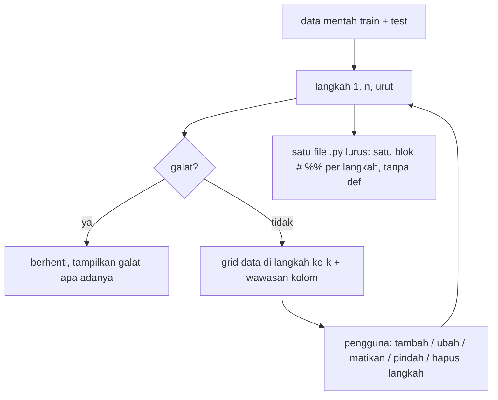

- **Langkah** = `{op, params, on}`; katalog 22 operasi di `core/ops.py` (kolom, teks, kosong, baris, angka,
  encoding). Setiap operasi punya *apa / kapan cocok / kapan berbahaya* dan menghasilkan blok pandas lurus.
- **Statistik dari train** disimpan di variabel biasa lalu dipakai di `for df in (train, test):`; baris hanya
  dibuang dari train; `test` selalu ada (kosong bila tidak punya file test) jadi tidak perlu cabang.
- **Satu sumber**: aplikasi `exec` blok yang sama dengan file unduhan (`core/steps.py`), termasuk batas
  outlier di tab Outlier.
- **Pratinjau** setiap langkah sebelum ditambah: baris dibuang, kolom baru/hilang, sel berubah (sebelum | sesudah).
- **Clustering ejaan** (OpenRefine): key collision (fingerprint, aman, dicentang) + nearest neighbor rapidfuzz
  (tidak dicentang; contoh salah: Kota Malang → Kota Magelang) + skrub.deduplicate (opsional).
- **AutoGluon** (`core/ag.py`): (1) skor mentah vs sesudah langkah di baris uji 20% yang sama (bagian uji
  diperlakukan seperti test), (2) permutation importance (kolom id penting = curiga bocor), (3) probabilitas
  out-of-fold bagging 5-fold untuk cleanlab (fold berurutan: spawn Windows), (4) langkah opsional
  `AutoMLPipelineFeatureGenerator`.
- Tab: Data · Temuan · Operasi · Ejaan · Isian bebas · Outlier · Label · Train vs test · AutoGluon · Kode & ekspor · Laya.
- Uji: `tests/test_steps.py` (semua operasi di data riil + test berantakan + data sintetis; skrip tanpa
  def/lambda; skrip mandiri = hasil aplikasi), `tests/test_tools.py`, `tests/test_app.py` (AppTest).

---

## (Rencana versi 2, sebagian diganti bagian 0)

Dibuat ulang dari nol. Kode lama tidak dijadikan patokan. Setiap tab punya flowchart; setiap
kotak di flowchart = satu fungsi yang bisa diuji.

## 1. Tujuan (satu kalimat)

Masuk: `train.csv` (+ `test.csv` opsional) dan nama kolom label.
Keluar:

1. **Temuan EDA** yang bisa dibaca: masalah apa, di kolom mana, berapa baris, contohnya.
2. **Data bersih**: `train_bersih.csv` dan `test_bersih.csv`, **kolom sama dengan masukan**.
3. **Kode pipeline** (`pipeline_eda.py` + `.ipynb`) yang menghasilkan data bersih itu persis
   sama, dan bisa dipakai lagi untuk test/inferensi.

## 1a. Sifat aplikasi

Laya EDA adalah **alat bantu**, bukan mesin yang langsung mencetak data training. Setiap
metode, termasuk yang hasilnya bisa salah (skrub.deduplicate, encoder skrub, MAD), tersedia
sebagai **pilihan** dengan penjelasan: apa yang dilakukan, kapan cocok, kapan berbahaya, dan
contoh hasilnya di data kamu. Pengguna yang memutuskan.

**Gaya kode yang dihasilkan:** Python EDA yang umum dipakai: pandas (vektorisasi, method
chaining), numpy, scikit-learn (`Pipeline`, `ColumnTransformer`, `SimpleImputer`,
`OneHotEncoder`, `OrdinalEncoder`), skrub, pandera, joblib. Boleh comprehension, lambda, type
hint. Tidak memakai gaya "primitif" (loop manual untuk hal yang bisa divektorisasi).

## 1b. Seberapa kacau data riilnya (`data/train.csv`, 30.380 baris × 28 kolom)

Hasil audit semua kolom (skripnya nanti masuk `uji/audit_kekacauan.py`). Setiap baris di tabel ini harus
ditemukan otomatis oleh aplikasi.

| Jenis kekacauan | Contoh nyata | Ditangani di |
|---|---|---|
| Spasi di belakang | `'Kota Semarang '` 1666 vs `'Kota Semarang'` 1582 | 4.4 |
| Singkatan | `Kab. Semarang` 676 vs `Kabupaten Semarang ` 683 | 4.4 |
| Huruf besar/kecil | `Batu bata` / `batu bata` / `Batu Bata` / `BATU BATA`; `kipk`/`KIPK` | 4.4 |
| Tanda baca di kode | `D-1`, `D.1`, `' D1'`; `S-3`, `S3 `, `S- 3` | 4.4 |
| Sinonim jenjang | `SLTA`, `SMA`, `MA`, `SLTA Sederajat` (masing-masing ±3000) | 4.4 + Laya |
| Penanda kosong palsu | Riwayat Beasiswa `-` 6334 baris; Bahan `-`/`0` | 4.3 |
| Kosong = "tidak" | Status Kepesertaan: 1 nilai (`KIS/JKS/BPJS`) + 4988 kosong | 4.3 |
| Isian bebas multi-bahan + salah ketik | Bahan Tembok 3266 variasi, 4632 sel berisi >1 bahan | 4.4 + 4.10 |
| Angka penjaga (overflow) | `2147483647` di 6 kolom; varian rusak `2156483647`, `2347483647`, `2597528647`; `2000000000` | 4.3 |
| Angka mustahil | Tanggungan 10000; Daya Listrik 2.200.000 W; Daya Listrik 0 (281) | 4.3 / 4.5 |
| Nol bermakna vs nol kosong | Total Hutang 0 di 15.632 baris (wajar), NJOP 0 di 3.023 (mencurigakan) | 4.3 / 4.5 |
| Logika antar kolom | luas bangunan > luas tanah 875; cicilan > total hutang 101; hutang 0 tapi cicilan > 0: 145 | 4.5 |
| Kolom kembar | Lokasi Tempat Tinggal ≈ Kota (99,2% sama); Kepemilikan Aset ≈ Status Kepemilikan Tempat Tinggal (99,3%) | 4.2 |
| Kategori berurutan | Pendapatan Keluarga (rentang Rp), Pendidikan (SD < SMP < SMA < S1 ...) | 4.10 |
| Label timpang | Golongan UKT 1 hanya 125 baris (yang lain 2.300–6.600) | 4.8 / 4.11 |
| Kosong tersebar | ±200 kosong di hampir tiap kolom; 105 baris kosong ≥ 5 kolom | 4.6 / 4.7 |
| Tidak ada | duplikat persis 0, konflik label 0, ID unik | (tetap dicek) |

Pemisah multi-nilai **tidak** boleh dipakai di semua kolom: `Program Studi` berisi koma di
namanya ("Pendidikan Jasmani, Kesehatan, dan Rekreasi") dan `Pendidikan` berisi `/`
("SD/MI Sederajat"). Pecah multi-bahan hanya untuk kolom yang ditandai "isian bebas".

## 2. Prinsip yang tidak boleh dilanggar

| # | Prinsip | Cara memastikannya |
|---|---|---|
| P1 | Kolom asli tidak pernah di-rename atau hilang diam-diam. Kolom baru **hanya** dari encoding yang dipilih pengguna (one-hot `<kolom>_<nilai>`, atau encoder skrub), dan daftar kolom barunya tampil sebelum dipakai. | Cek otomatis di akhir pipeline: kolom = kolom asli + daftar one-hot yang dipilih, tidak lebih; gagal = error, file tidak disimpan |
| P2 | Data di aplikasi dibuat oleh **kode yang sama** dengan kode yang diekspor | Aplikasi menjalankan kode hasil generate, bukan logika terpisah |
| P3 | Statistik (median, batas outlier, ejaan baku) dihitung dari **train saja**, lalu dipakai ke train dan test | Setiap langkah punya bagian `fit` (train) dan `apply` (train + test) |
| P4 | Baris test **tidak pernah dibuang** | Langkah buang baris hanya menyentuh train |
| P5 | Setiap perubahan terlihat **sebelum → sesudah** (berapa sel/baris berubah, contohnya) | Tiap langkah wajib mengembalikan ringkasan perubahan |
| P6 | Tidak ada yang mengubah data tanpa dipilih. Aplikasi boleh **menyarankan**, pengguna yang **menyetujui** | Default setiap aksi = "biarkan" kecuali disetujui |
| P7 | Diuji dengan **data riil** (`data/train.csv`) dan data tiruan yang sengaja berantakan | Checklist bagian 5 |

## 3. Arsitektur

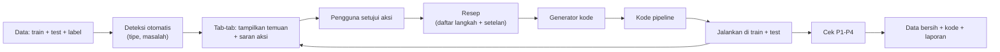

- **Resep** = satu dict berisi langkah-langkah berurutan dan setelannya. Ini satu-satunya
  sumber kebenaran. Disimpan sebagai `resep.json`, jadi sesi bisa dilanjutkan.
- **Satu langkah** = tiga fungsi: `detect(train, test)` → saran, `ui(saran)` → setelan,
  `code(setelan)` → teks kode Python.
- Urutan langkah di pipeline tetap (lihat flowchart Kode pipeline), tidak tergantung urutan
  pengguna membuka tab.
- **Supaya kode robust:** setiap langkah pembersihan = transformer scikit-learn
  (`fit` di train, `transform` di train/test). Seluruh pipeline = `sklearn.pipeline.Pipeline`
  yang bisa disimpan dengan `joblib` dan dipakai ulang saat inferensi. Di ujung pipeline ada
  skema **pandera** (tipe, rentang, nilai yang boleh) yang dibuat dari train. Kalau test
  melanggar, error-nya jelas, bukan diam-diam salah.

## 3b. Metode dan library (riset + diuji di data riil)

Tanpa LLM: semua langkah memakai library dan aturan yang hasilnya bisa diulang. Laya tetap
ada sebagai alat bantu melihat konteks (4.14), tapi bukan bagian dari pipeline.

| Masalah | Metode / library | Hasil uji di `data/train.csv` | Keputusan |
|---|---|---|---|
| Tipe kolom, teks angka, tanggal | `skrub.Cleaner(parse_numbers=True, null_strings=[...])` | Kolom tetap 28. Tanpa `null_strings`, `-` di Riwayat Beasiswa (6334) **tidak** tertangkap | Pakai, dengan daftar penanda kosong dari 4.3 |
| Penanda kosong palsu, angka penjaga | aturan pandas: daftar penanda + `>= 2^31-1` / varian `…483647` | tertangkap semua (6 kolom) | Pakai |
| Kolom kembar | `skrub.column_associations` (Cramér's V) | Lokasi ↔ Kota 0,94; Aset ↔ Status tinggal 0,86 | Pakai sebagai saran |
| Spasi, huruf besar/kecil, tanda baca, urutan kata | **fingerprint key collision** (cara OpenRefine): huruf kecil, buang tanda baca, rapikan spasi, normalisasi unicode | metode dengan salah gabung paling sedikit (menurut dokumentasi OpenRefine) | Pakai, langkah pertama |
| Singkatan | kamus singkatan (Kab. → Kabupaten) | `Kab. Semarang` = `Kabupaten Semarang ` | Pakai |
| Salah ketik per kata | `rapidfuzz` (Levenshtein ratio) pada kosakata kata | gentng→genting, bta→bata, kermaik→keramik; salah: tanpa→tanah, sengon→seng | Pakai, **wajib** tabel peta + persetujuan |
| Gabung variasi otomatis | `skrub.deduplicate` (n-gram + hierarchical clustering) | salah gabung: `S- 3`→`S-2`, `Kab. Semarang`→`Kota Semarang`; 67 detik di Bahan Lantai; `kermaik` tidak dibetulkan | **Fitur opsional**: tampil sebagai usulan peta, dengan penjelasan kapan cocok (banyak ejaan, sedikit kategori asli) dan kapan berbahaya (nama wilayah, kode jenjang); pengguna atur `n_clusters` / `ngram_range` dan setujui per baris |
| Encoding kategori kotor | `skrub` MinHash/Gap/StringEncoder | hasilnya kolom angka tanpa nama yang bisa dibaca | **Fitur opsional** di tab Encoding: penjelasan apa artinya, kapan berguna (model pohon/linear di isian bebas yang sangat kotor), pratinjau daftar kolom baru sebelum dipakai |
| One-hot / ordinal | `sklearn` `OneHotEncoder(handle_unknown="infrequent_if_exist", min_frequency=...)`, `OrdinalEncoder(categories=[urutan], handle_unknown="use_encoded_value")` | — | Pakai, opsional |
| Outlier 1 kolom, angka kontinu (harga, luas) | IQR di skala log10, nol dihitung terpisah | NJOP: IQR 2520, MAD 1468; penjaga tertangkap keduanya | Pakai IQR log; MAD sebagai pembanding |
| Outlier 1 kolom, angka diskret kecil (tanggungan) | IQR linear | MAD menandai 10.832 baris; IQR 126 | Pilihan metode per kolom: IQR / IQR-log / MAD / MAD-log, dengan perbandingan jumlah baris tiap metode dan peringatan kalau sebaran = 0 |
| Outlier kombinasi kolom | `sklearn.ensemble.IsolationForest` | — | Hanya penanda, tidak membuang otomatis |
| Aturan logika antar kolom | cek pandera (`Check`) | bangunan > tanah 875, cicilan > hutang 101 | Pakai sebagai penanda |
| Isi kosong | `sklearn.impute.SimpleImputer` (median / most_frequent), fit di train | — | Pakai; `KNNImputer` opsional; `add_indicator` menambah kolom → opsional |
| Label salah, baris hampir kembar | `cleanlab.Datalab` (butuh prediksi model lewat cross-validation) | cleanlab 2.9 sudah terpasang | Penanda di tab Label, tidak mengubah data |
| Ringkasan data | `skrub.TableReport` | — | Pakai di tab Ringkasan |
| Validasi akhir | `pandera.DataFrameSchema` dibuat dari train | pandera 0.35 terpasang | Pakai (P1, P3, P4) |

Terpasang di `.venv`: scikit-learn 1.9.1, skrub 0.11.0, pandera 0.35.0, rapidfuzz 3.14.6,
cleanlab 2.9.0, pandas 2.3.3.

Sumber: dokumentasi [skrub](https://skrub-data.org/stable/reference/index.html),
[skrub.deduplicate](https://skrub-data.org/stable/reference/generated/skrub.deduplicate.html),
[skrub.Cleaner](https://skrub-data.org/stable/reference/generated/skrub.Cleaner.html),
[OpenRefine clustering](https://openrefine.org/docs/technical-reference/clustering-in-depth),
[cleanlab Datalab tabular](https://docs.cleanlab.ai/master/tutorials/datalab/tabular.html),
[sklearn KNNImputer](https://scikit-learn.org/stable/modules/generated/sklearn.impute.KNNImputer.html),
[RapidFuzz](https://github.com/rapidfuzz/RapidFuzz),
[Pandera vs Great Expectations](https://endjin.com/blog/a-look-into-pandera-and-great-expectations-for-data-validation),
[outlier MAD vs IQR](https://www.kdnuggets.com/5-essential-approaches-to-robust-outlier-detection).

## 4. Tab dan flowchart

Urutan tab mengikuti urutan kerja EDA.

### 4.0 Panel samping: Data

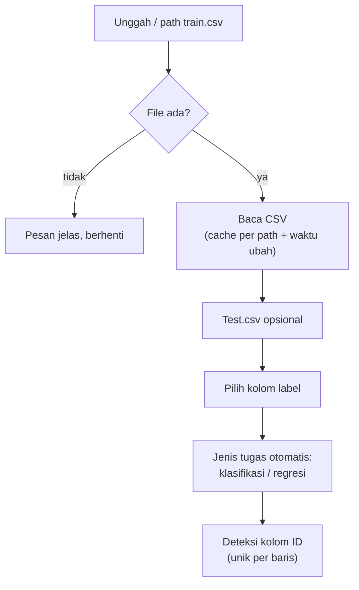

### 4.1 Tab Ringkasan

Apa isi data, dan masalah apa yang paling besar.

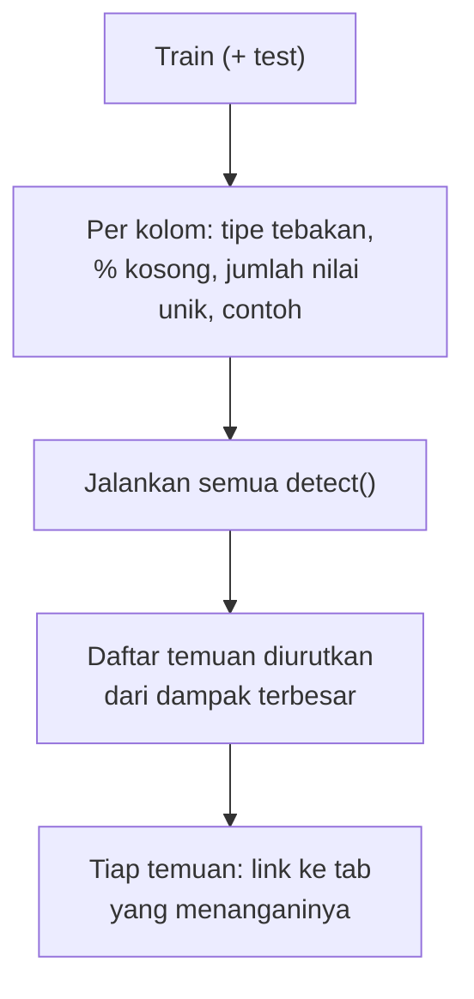

### 4.2 Tab Tipe kolom

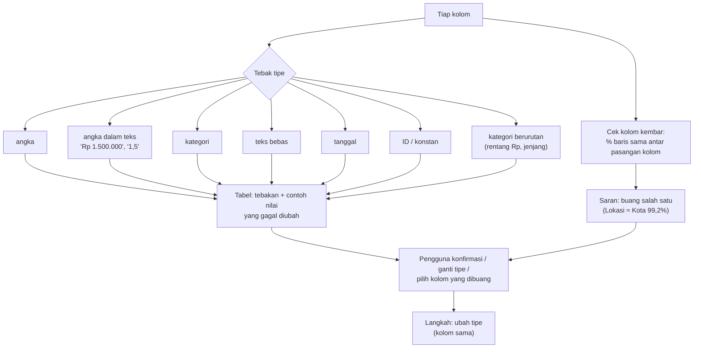

Kategori "isian bebas" ditandai di sini; hanya kolom ini yang dipecah multi-bahan di 4.4.

### 4.3 Tab Nilai kosong & penanda palsu

Nilai yang sebenarnya "tidak tahu", tapi ditulis sebagai data.

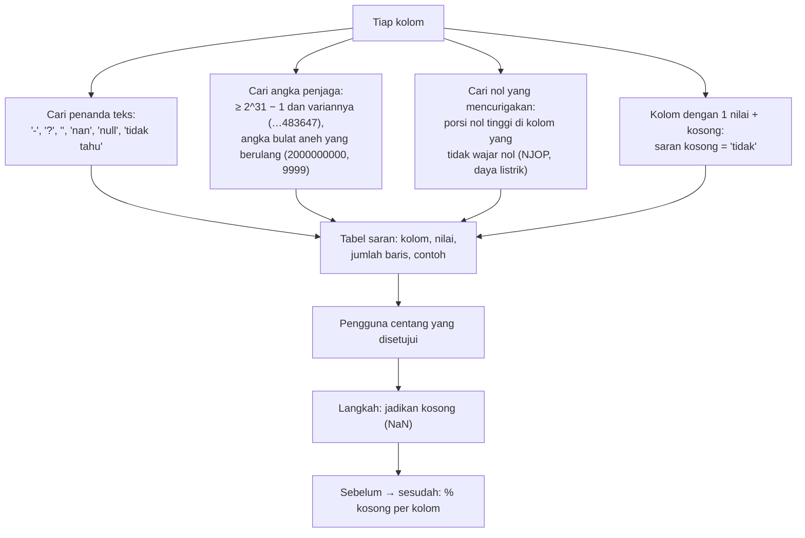

Contoh dari data riil: `2147483647` muncul di 6 kolom (NJOP per Meter 54 baris);
`Daya Listrik (Watt) = 0` di 281 baris.

### 4.4 Tab Kategori

Dua jenis kolom kategori, ditangani berbeda:

- **Kategori rapi** (sedikit nilai, mis. Riwayat Beasiswa, Pendidikan, Kota): rapikan
  spasi + huruf besar/kecil, lalu:

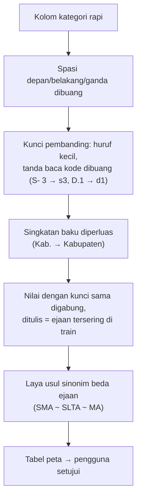
- **Isian bebas** (ribuan variasi, mis. Bahan Atap/Tembok/Lantai): satu sel bisa berisi
  beberapa bahan ("genteng dan asbes", "bata,semen") dan salah ketik ("gentng", "bta",
  "kermaik"). Ditangani per **kata**, bukan per sel.

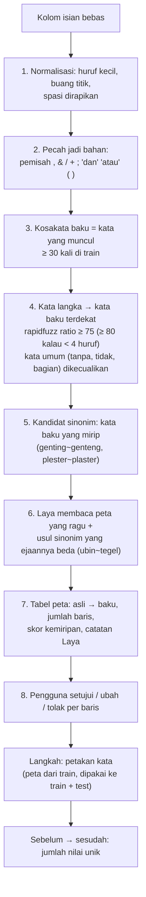

**Sudah diuji di `data/train.csv`** (rapidfuzz 3.14, langkah 1–5):

| Asli | Hasil | Benar? |
|---|---|---|
| gentng, geting, gentig, geneng, gentheng | genting / genteng | ya |
| bta, bat, bara | bata | ya |
| kermaik, keremik, keramk, keramaik, dikeramik | keramik | ya |
| asbas, esbes | asbes | ya |
| baru (di "baru bata") | batu | ya |
| tekhel, teghel, tihel | tekel / tegel / tehel | ya (lalu disatukan di langkah 5–6) |
| tanpa → tanah, tidak → dak, sengon → seng | | **salah**: sebab itu ada daftar kata umum, catatan Laya, dan persetujuan pengguna |
| ubin ~ tegel | tidak terdeteksi (ejaan beda) | sebab itu Laya mengusulkan sinonim |

Kesimpulan: pencocokan ejaan saja **tidak** cukup aman untuk dipakai otomatis. Hasilnya
selalu berupa tabel peta yang diperiksa dulu.

### 4.5 Tab Angka & outlier

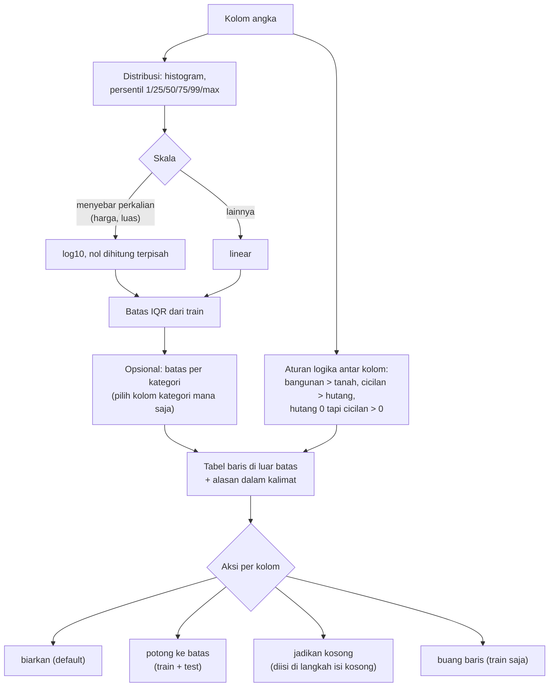

Tidak bergantung pada Laya atau MiniLM. Pembanding kategori = kolom apa saja di data.

### 4.6 Tab Duplikat & baris rusak

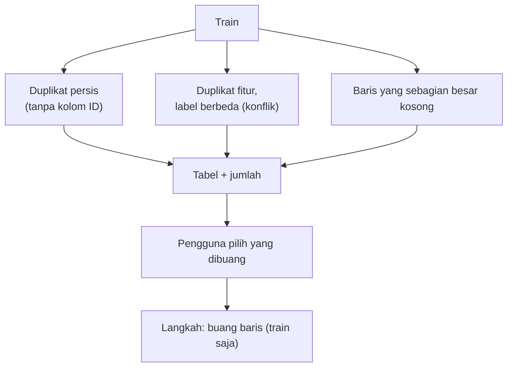

### 4.7 Tab Isi kosong

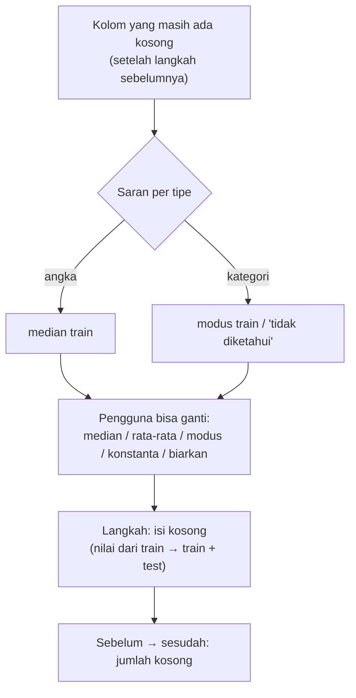

### 4.8 Tab Label & hubungan

EDA saja; tidak mengubah data.

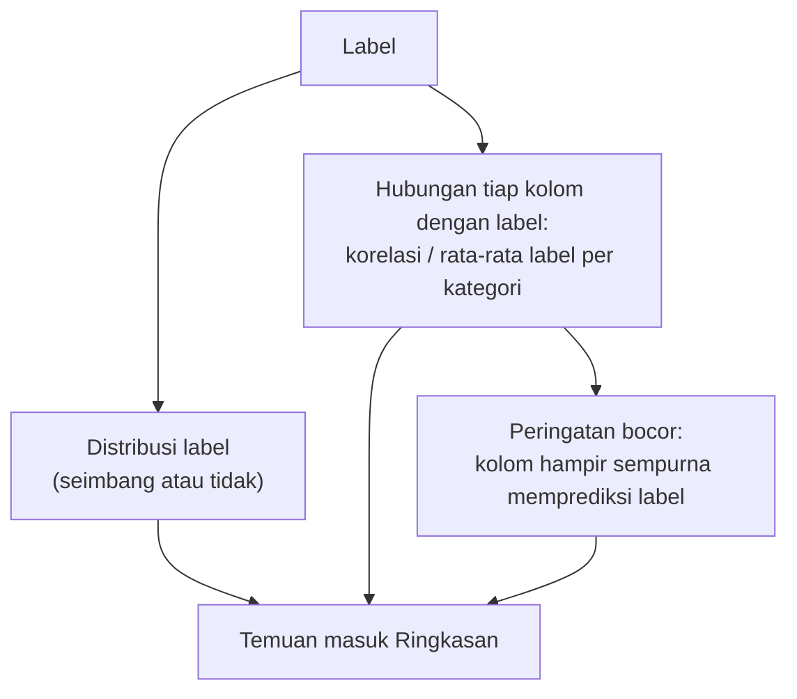

### 4.9 Tab Train vs test

Hanya aktif kalau ada test. EDA saja.

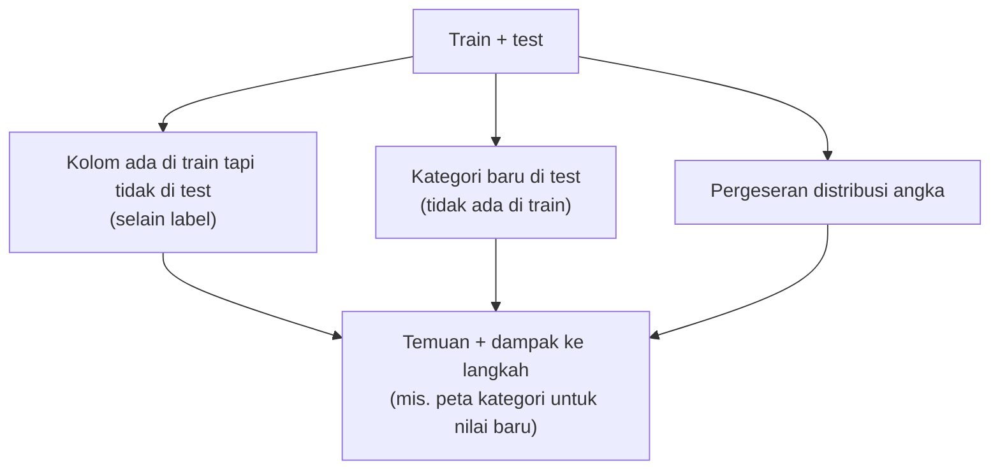

### 4.10 Tab Encoding (opsional)

Encoding dijalankan **setelah** peta kata (4.4), jadi "gentng" dan "genteng" sudah satu
kata sebelum di-encode.

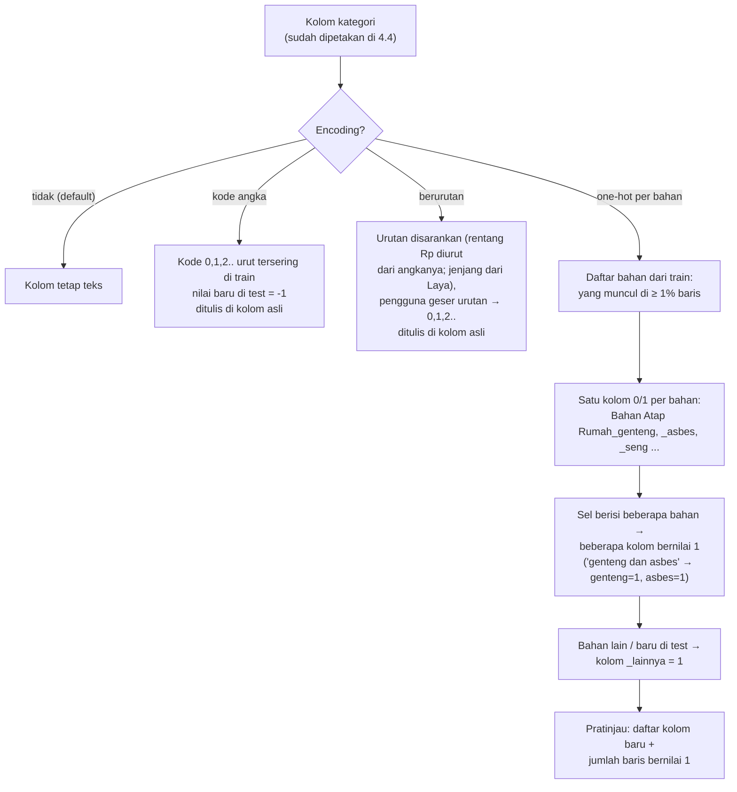

One-hot per bahan **menambah kolom**, jadi hanya jalan kalau dipilih, dan daftar kolom
barunya tampil sebelum disetujui.

### 4.11 Tab Split

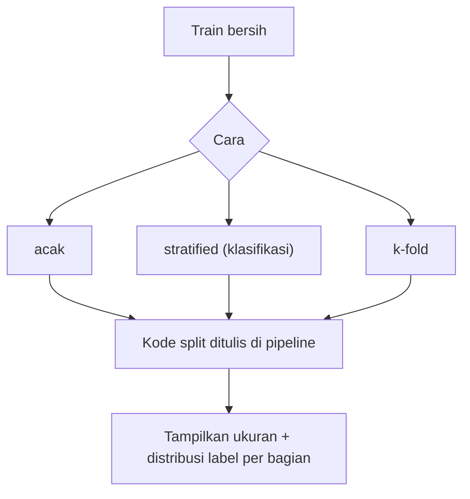

### 4.12 Tab Kode pipeline

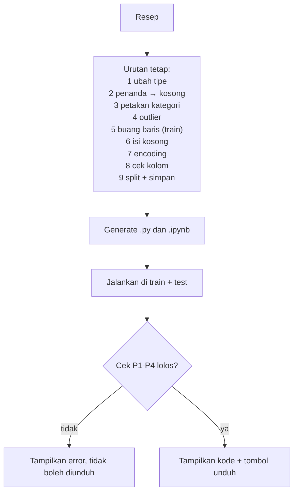

### 4.13 Tab Ekspor

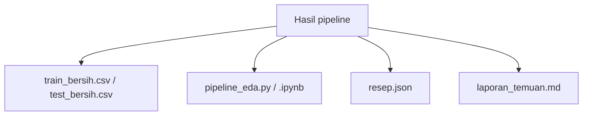

### 4.14 Peran Laya: melihat data secara kontekstual

Jawaban Laya dipakai **tidak langsung**: untuk membantu melihat dan memutuskan, tidak pernah
ditulis ke data bersih.

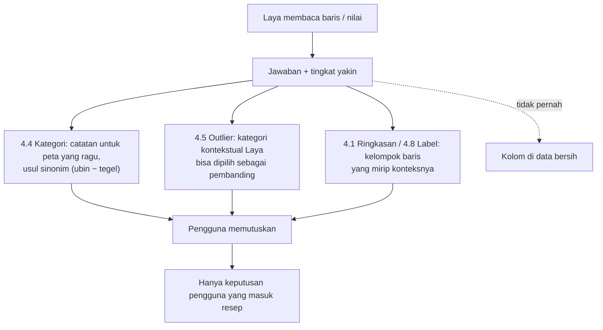

- Laya tidak wajib: semua tab tetap jalan tanpa Laya. Kalau Laya belum dijalankan, kolom
  "catatan Laya" kosong dan pembanding Laya tidak muncul di pilihan.
- Encoding berbasis makna (MiniLM → angka) **tidak** dipakai. Alasannya terukur di data
  riil: "Kab. Sragen"/"Kab. Bogor" mirip 0,89, tapi "genting"/"Genteng" cuma 0,58.

## 5. Checklist

### A. Cara kerja (wajib tiap tab)

- [ ] Flowchart tab disetujui pengguna **sebelum** kode ditulis
- [ ] Flowchart yang sama tampil di dalam tab (expander "Cara kerja", `st.graphviz_chart`)
- [ ] Setiap kotak flowchart = satu fungsi dengan tes
- [ ] Tes jalan di `data/train.csv` dan data tiruan berantakan
- [ ] Server di-restart, tab dicek di browser, tidak ada error
- [ ] Baru lapor selesai setelah semua di atas

### B. Fondasi

- [ ] Struktur baru: `app.py`, `resep.py`, `langkah/` (satu file per langkah), `tab/`, `uji/`
- [ ] Format `resep.json` + simpan/muat
- [ ] Generator kode: resep → `.py` dan `.ipynb`
- [ ] Runner: jalankan kode di train + test, kembalikan hasil + ringkasan per langkah
- [ ] Cek akhir P1 (kolom sama), P3, P4 (jumlah baris test tetap)
- [ ] Tiap langkah = transformer sklearn (`fit`/`transform`), lolos
      `sklearn.utils.estimator_checks` yang relevan
- [ ] Pipeline disimpan `joblib`, dimuat ulang di proses baru → hasil test identik
- [ ] Skema pandera dari train; test yang melanggar → error jelas (kolom, nilai, baris)
- [ ] Uji robust: kolom test hilang, kolom tambahan, urutan kolom beda, tipe beda
      ("1.500" teks), kategori baru, kolom kosong semua, satu baris saja
- [ ] Data tiruan berantakan: angka dalam teks, penanda palsu, 2147483647, beda huruf,
      ejaan mirip, duplikat, label konflik, kategori baru di test

### C. Per tab (centang kalau lolos A)

- [ ] 4.0 Data
- [ ] 4.1 Ringkasan
- [ ] 4.2 Tipe kolom
- [ ] 4.3 Nilai kosong & penanda palsu
- [ ] 4.4 Kategori
- [ ] 4.5 Angka & outlier
- [ ] 4.6 Duplikat & baris rusak
- [ ] 4.7 Isi kosong
- [ ] 4.8 Label & hubungan
- [ ] 4.9 Train vs test
- [ ] 4.10 Encoding
- [ ] 4.11 Split
- [ ] 4.12 Kode pipeline
- [ ] 4.13 Ekspor

### D. Uji terima dengan data riil (`data/train.csv`, label Golongan UKT)

- [ ] Ringkasan menemukan `2147483647` di 6 kolom angka
- [ ] Ringkasan menemukan nol mencurigakan (mis. Daya Listrik 0 di 281 baris)
- [ ] Riwayat Beasiswa: `kipk` dan `KIPK` jadi satu; `-` jadi kosong (setelah disetujui)
- [ ] Bahan Atap/Tembok/Lantai: jumlah nilai unik turun, peta bisa diperiksa per baris
- [ ] Peta kata: gentng→genting, bta→bata, kermaik→keramik, asbas→asbes
- [ ] Peta kata tidak salah gabung: tanpa ≠ tanah, tidak ≠ dak, sengon ≠ seng
- [ ] One-hot per bahan: "genteng dan asbes" → `_genteng`=1 dan `_asbes`=1; test dengan
      bahan baru → `_lainnya`=1
- [ ] Laya mengusulkan ubin ~ tegel, dan usulan itu baru masuk resep setelah disetujui
- [ ] Semua 16 baris tabel 1b ditemukan otomatis oleh tab Ringkasan
- [ ] `Kota Semarang ` + `Kota Semarang` jadi satu; `Kab. Pati` = `Kabupaten Pati`
- [ ] Pendidikan: `S-3`/`S3 `/`S- 3` jadi satu; Laya mengusulkan SMA ~ SLTA ~ MA
- [ ] Varian `…483647` dan `2000000000` disarankan jadi kosong
- [ ] Kolom kembar Lokasi ≈ Kota dan Aset ≈ Status tinggal disarankan
- [ ] Program Studi **tidak** dipecah di koma
- [ ] Outlier jalan tanpa menjalankan Laya/MiniLM
- [ ] Semua tab jalan tanpa Laya
- [ ] `train_bersih.csv` kolomnya sama persis dengan `train.csv`
- [ ] Kode `.py` dijalankan sendiri (di luar aplikasi) → file identik dengan hasil aplikasi
- [ ] Test dengan kategori baru diproses tanpa error, jumlah baris tetap
- [ ] Ganti setelan di satu tab → muat ulang < 2 detik

## 6. Yang perlu kamu putuskan

1. Kode lama: dibuang total (folder baru), atau ditimpa di `_laya_eda/`?
2. Aksi default outlier: "biarkan" (rencana ini) atau "potong ke batas"?
3. Ambang kosakata baku (≥ 30 kali) dan ambang kemiripan (75): boleh dipakai sebagai awal?
