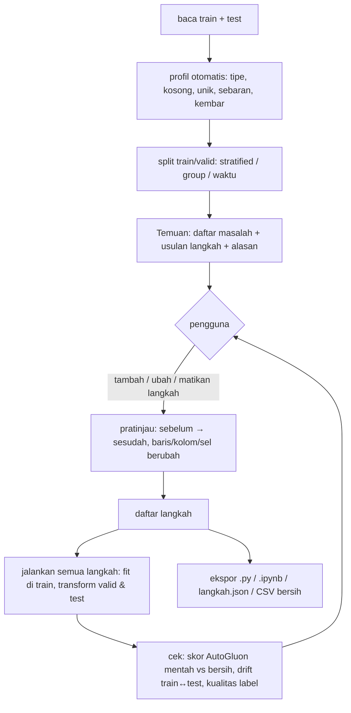

# Laya EDA — versi ideal

Laya EDA = software yang (1) **menganalisis** data tabular seperti data scientist berpengalaman dan (2) **menulis
kode EDA lengkap** yang bisa ditempel ke notebook lomba, dijalankan dari atas ke bawah, dan memberi hasil persis
sama dengan yang terlihat di aplikasi.

Dokumen ini = target akhir. `RENCANA.md` = status kerja saat ini.

---

## 1. Requirement (wajib, diuji otomatis)

| # | Requirement | Cara memastikan |
|---|---|---|
| R1 | Tidak ada yang berubah sebelum pengguna menambah langkah | data di langkah 0 = data mentah sesudah split; uji: proyek kosong → hash data tetap |
| R2 | Statistik/model hanya di-*fit* di **train** | semua transformer `fit` di train, `transform` di valid/test; uji: ubah isi test → parameter langkah tidak berubah |
| R3 | Baris **valid & test tidak pernah dibuang** | op drop hanya menyentuh `train`; uji: `len(test)` sama sebelum/sesudah semua langkah |
| R4 | Kode hasil = satu file lurus: blok `# %%` per langkah, **tanpa `def`/`lambda`/class** | uji AST: tidak ada `FunctionDef`, `Lambda`, `ClassDef` |
| R5 | Aplikasi menjalankan **kode yang sama** dengan file unduhan | `exec` blok yang sama; uji: skrip mandiri (subprocess) = hasil aplikasi, sel per sel |
| R6 | **Peta typo hardcoded ≤ 300 baris total** di seluruh skrip (target ≤ 200) | uji menghitung baris dict literal per langkah; lewat batas → aplikasi menolak dan menawarkan versi aturan/library |
| R7 | Selain peta typo yang wajar, kode **memakai library**, bukan tulisan ulang manual | katalog op menunjuk satu library per tugas (bagian 3) |
| R8 | Default **tidak ganti nama kolom / tidak menambah kolom tak bermakna** | kolom baru hanya dari op yang memang membuatnya (encoding, indikator kosong), selalu terlihat di pratinjau |
| R9 | Setiap metode opsional punya **apa / kapan cocok / kapan berbahaya** | uji: semua entri katalog punya tiga teks itu |
| R10 | Setiap tab punya **flowchart** cara kerja (nama library di node) | uji: semua tab terdaftar di `ui/flows.py` |
| R11 | Galat tampil apa adanya, tidak ditelan | langkah gagal → berhenti di langkah itu, pesan asli + nomor langkah |
| R12 | Kode tahan **kategori/ejaan baru di test** | aturan dipelajari dari train lalu diterapkan ke nilai apa pun (bukan daftar nilai train saja); uji dengan test berantakan buatan |
| R13 | Skrip jalan di Windows (cp1252) & Linux | tanpa non-ASCII di `print`; uji subprocess dengan output dipipe |
| R14 | Reproducible | `random_state` tetap di semua op acak; versi library dicetak di blok pertama skrip |

Anggaran ukuran skrip: wajar < **400 baris** untuk dataset ±25 kolom. Aplikasi menampilkan baris per langkah dan
memperingatkan langkah > 40 baris.

---

## 2. Alur kerja pengguna



Prinsip: Laya **mengusulkan**, pengguna **memutuskan**. Tidak ada langkah otomatis.

---

## 3. Analisis + library per tugas

Pilihan = library terkuat yang saya ketahui (per pertengahan 2026); versi dikunci di `requirements.txt` dan
dicek ulang sebelum dipakai.

| Tugas | Analisis di aplikasi | Kode yang dihasilkan |
|---|---|---|
| Profil & laporan | `ydata-profiling` (opsional, laporan HTML), profil sendiri yang cepat | — (hanya analisis) |
| Validasi skema | `pandera`: tipe, rentang, nilai sah per kolom, dipelajari dari train | `schema = pa.DataFrameSchema({...}); schema.validate(test, lazy=True)` |
| Tipe & konversi | deteksi angka-teks, tanggal, checkbox, sentinel (2^31−1, 9999) | `pd.to_numeric(errors="coerce")`, `pd.to_datetime(format=...)`, `skrub.Cleaner` |
| Ejaan kategori | key collision (fingerprint OpenRefine) + kamus singkatan | aturan kunci pandas `.str` + `GABUNG` pendek (≤ R6) |
| Typo / sinonim panjang | `rapidfuzz` (cdist, extractOne), `skrub.deduplicate` | kosakata baku dipelajari dari train → `rapidfuzz.process.extractOne` untuk nilai apa pun di valid/test (tahan ejaan baru, R12) |
| Isian bebas (multi-nilai) | peta kata + frasa, kata pengisi | `.str.split().explode()` + peta kata/frasa ringkas, atau `skrub.StringEncoder`/`GapEncoder` bila tujuannya fitur model |
| Kosong | pola kosong `missingno`, uji MCAR vs bergantung kolom lain | `sklearn.impute.SimpleImputer` / `IterativeImputer` / `KNNImputer` + `add_indicator=True`; kosong sebagai kategori bila bermakna |
| Outlier | IQR, MAD (log), `pyod` (ECOD, IsolationForest), per kelompok label | `feature_engine.outliers.Winsorizer` (clip) / `ArbitraryOutlierCapper`; drop hanya di train |
| Kategori langka | frekuensi per kolom, kategori hanya di test | `feature_engine.encoding.RareLabelEncoder` |
| Encoding | kardinalitas, kebocoran target | `OneHotEncoder(handle_unknown="infrequent_if_exist")`, `OrdinalEncoder` (urutan dari Laya/ordinal_order), `sklearn.preprocessing.TargetEncoder` (cross-fitting bawaan) |
| Skala & transformasi | skew, distribusi | `PowerTransformer` / `QuantileTransformer` / `StandardScaler` |
| Duplikat & kolom kembar | baris kembar, kolom identik/terkorelasi sempurna | `drop_duplicates` (train), `feature_engine.selection.DropDuplicateFeatures` / `DropCorrelatedFeatures` |
| Kolom id / bocor | permutation importance AutoGluon, korelasi dengan label | `drop(columns=[...])` dengan alasan di komentar |
| Fitur baru (opsional) | `AutoGluon AutoMLPipelineFeatureGenerator`, `openfe` | generator di-fit di train, transform valid/test |
| Kualitas label | `cleanlab.find_label_issues` dengan probabilitas OOF AutoGluon bagging | — (hanya analisis; label tidak diubah otomatis) |
| Drift train↔test | `scipy.stats.ks_2samp`, adversarial validation (classifier train vs test), `evidently` opsional | — (hanya analisis) |
| Skor dampak | AutoGluon mentah vs bersih di baris uji yang sama + papan model | — |
| Penjelasan model | SHAP / permutation importance | — |
| Konteks makna | Laya (LLM): "apakah dua ejaan ini sama makna?", urutan ordinal | hasil disimpan terpisah, tidak masuk data bersih |

### Bentuk kode berbasis library (tetap tanpa `def`, R4)

```python
# %% Langkah 7: isi kosong (median, statistik dari train) + indikator
from sklearn.impute import SimpleImputer
KOLOM = ["Luas Tanah Rumah (m2)", "NJOP per Meter"]
imputer = SimpleImputer(strategy="median", add_indicator=True).set_output(transform="pandas")
imputer.fit(train[KOLOM])
for df in (train, valid, test):
    df[imputer.get_feature_names_out()] = imputer.transform(df[KOLOM])

# %% Langkah 9: bakukan ejaan Kota (kosakata dari train, berlaku untuk ejaan baru di test)
from rapidfuzz import process, fuzz
jumlah = train["Kota"].value_counts()
BAKU = list(jumlah[jumlah >= 5].index)
for df in (train, valid, test):
    unik = df["Kota"].dropna().unique()
    cocok = {nilai: process.extractOne(nilai, BAKU, scorer=fuzz.WRatio, score_cutoff=90) for nilai in unik}
    peta = {nilai: hasil[0] for nilai, hasil in cocok.items() if hasil is not None}
    df["Kota"] = df["Kota"].replace(peta)
```

Satu pola untuk semua: **fit di train → simpan di variabel biasa → `for df in (train, valid, test)`**.

---

## 4. Aturan khusus typo (R6)

1. Lapisan 1, **aturan** (0 baris peta): huruf kecil, spasi, tanda baca, singkatan (`Kab.` → `Kabupaten`),
   urutan kata. Menangani mayoritas variasi.
2. Lapisan 2, **peta hardcoded wajar**: hanya pasangan yang aturan tidak bisa (SMA = MA = SLTA, bata merah = batu
   bata). Ditampilkan dengan alasan, dicentang pengguna. Total seluruh skrip ≤ 300 baris.
3. Lapisan 3, **library saat runtime**: kosakata baku dari train + `rapidfuzz` ambang tetap → nilai baru di test
   ikut terpetakan tanpa daftar.
4. Bila lapisan 2 akan melewati batas, aplikasi tidak menambah peta lagi; menawarkan lapisan 3 atau encoder teks
   (`skrub.StringEncoder`) dengan penjelasan risiko (contoh salah gabung: Kota Malang → Kota Magelang).

---

## 5. Tab aplikasi

Data · Split · Temuan · Operasi · Ejaan · Isian bebas · Kosong · Outlier · Encoding · Label · Train vs test ·
AutoGluon · Kode & ekspor · Laya. Setiap tab: penjelasan singkat, flowchart, pratinjau sebelum tambah langkah.

Diagnosa yang selalu aktif: sel kosong baru per langkah, langkah kembar, langkah panjang (> 40 baris), kolom
kosong mencolok, langkah yang menurunkan skor AutoGluon.

---

## 6. Definisi selesai

- Semua requirement R1–R14 punya uji dan lulus di data riil (`Golongan UKT`) + test berantakan buatan + data sintetis.
- Skrip ekspor untuk data riil < 400 baris, peta typo ≤ 300 baris, jalan mandiri dan sama dengan aplikasi.
- Skor AutoGluon di data bersih ≥ data mentah pada baris uji yang sama (atau langkah penyebab turun ditandai).
