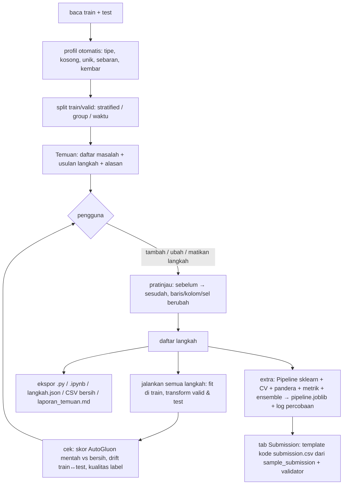

# Laya EDA — versi ideal

Laya EDA = software yang (1) **menganalisis** data tabular seperti data scientist berpengalaman dan (2) **menulis
kode EDA lengkap** yang bisa ditempel ke notebook lomba, dijalankan dari atas ke bawah, dan memberi hasil persis
sama dengan yang terlihat di aplikasi, plus (3) fitur **extra** yang menyelesaikan pipeline training dengan cepat
(bagian 0).

Dokumen ini = **satu-satunya** sumber tujuan, requirement, prinsip, pilihan library, dan uji terima Laya v2.
`RENCANA.md` hanya berisi status kerja, arsitektur yang sudah jalan, dan hasil uji di data riil (bukti, bukan
aturan). Kalau keduanya bertentangan, dokumen ini yang benar. Setiap perubahan dokumen ini atau kodenya ikut
memperbarui memori agen `../_memori/` (log, status, aturan/keputusan bila berubah) di commit yang sama.

---

## 0. Kedudukan: fitur extra di atas R1–R18

Ketetapan pengguna (2026-11-02): selain EDA, software ini punya fitur **extra** yang membuat pipeline training
selesai jauh lebih cepat: dari data bersih sampai model tervalidasi, tersimpan, dan `submission.csv`. Bagian ini
**lebih tinggi** dari requirement R1–R18: bila bertentangan, bagian ini yang menang. R1–R18 tetap berlaku untuk
fitur extra selama tidak bertentangan.

| # | Fitur extra | Isi | Cara memastikan |
|---|---|---|---|
| E1 | **Pipeline sklearn** | Langkah yang punya transformer sklearn/feature_engine (isi kosong, encoding, skala, winsorize, kategori langka) disusun jadi `ColumnTransformer` + `Pipeline(preprocess → model)`, `set_output(transform="pandas")` | uji: `pipe.fit(train)` lalu `pipe.predict(test)` = hasil blok kode EDA + model yang sama |
| E2 | **Simpan/muat joblib** | `joblib.dump(pipe, "pipeline.joblib")`; inferensi = `joblib.load` → `predict` → submission, tanpa latih ulang | uji: muat di proses baru → prediksi identik; versi sklearn dicetak dan disimpan di sebelah file |
| E3 | **Split & validasi silang** | k-fold, stratified, group, time series; `cross_validate(pipe, ...)` sehingga preprocessing di-fit ulang per fold (tanpa bocor); prediksi out-of-fold disimpan | uji: skor CV dengan pipeline ≤ skor dengan preprocessing di-fit di seluruh train (bukti tidak bocor) pada data sintetis yang sengaja bocor |
| E4 | **Validasi skema pandera** | `DataFrameSchema` dipelajari dari train (tipe, rentang, nilai sah) dan dicek ke test sebelum `predict`; `lazy=True` melaporkan semua pelanggaran sekaligus. Mode: **lapor** (default, lanjut) atau **ketat** (berhenti) | uji: test berantakan buatan → laporan berisi kolom, nilai, jumlah baris; mode lapor tetap menghasilkan prediksi |
| E5 | **Latih cepat** | model baseline siap pakai (LightGBM / CatBoost / XGBoost / AutoGluon) di atas pipeline E1, papan skor CV memakai metrik E7 | uji: semua model baseline jalan di data riil dan masuk papan skor |
| E6 | **Tab Submission: template kode `submission.csv`** | baca `sample_submission.csv` → nama kolom id & target, urutan id, tipe target (mis. `3`, bukan `3.0`). Tab menulis **kode template** siap tempel (blok lurus, tanpa `def`): muat pipeline/model (E2) → prediksi test → `pd.DataFrame()` baru, kolom ditambah satu per satu mengikuti sample → urutan id = sample → ubah tipe → validator → simpan. Validator: jumlah baris, himpunan & urutan id sama dengan sample, tanpa NaN, kelas ⊆ kelas train | uji: template jalan mandiri di data riil dan lolos validator; validator menolak submission rusak buatan (id hilang, urutan acak, `3.0`, NaN) |
| E7 | **Metrik + mode label berurutan** | pengguna memilih metrik lomba (accuracy, macro-F1, QWK, RMSE, MAE, dll.); semua CV, pemilihan model, dan ensemble memakai metrik itu. Label berurutan (bilangan bulat berurutan seperti `Golongan UKT` 0–7, atau kategori berurutan) → opsi regresi + ambang pembulatan optimal yang dicari di prediksi OOF, bukan di test | uji: data sintetis berurutan → QWK mode ambang ≥ klasifikasi biasa; ambang hanya dari OOF |
| E8 | **Log percobaan** | setiap latih menambah satu baris ke `percobaan.csv` di folder output (di luar repo): waktu, hash langkah EDA, model, parameter, skor CV per fold + rata-rata, lama latih. Tab menampilkan papan percobaan dan bisa membuka ulang setelan percobaan mana pun | uji: dua latih → dua baris; langkah beda → hash beda; buka ulang → skor sama |
| E9 | **Ensemble dari OOF** | rata-rata berbobot (bobot ≥ 0, jumlah 1, dicari di OOF) atau stacking (model meta dilatih di OOF); dibandingkan dengan model tunggal terbaik memakai metrik E7, dan hanya dipakai bila lebih baik | uji: bobot dihitung dari OOF saja; ensemble yang lebih buruk tidak dipilih |
| E10 | **Anggaran waktu + mode aman laptop** | mode **cepat** (≤ 5 menit) dan **lengkap**; `time_limit` untuk AutoGluon/Optuna; perkiraan lama sebelum jalan. Default CPU atau GPU dengan batch kecil (laptop pernah mati saat beban GPU berat) | uji: mode cepat selesai ≤ batas di data riil |
| E11 | **Analisis kesalahan + figur presentasi** | confusion matrix (nilai ditulis di sel), kelas paling sering salah, baris dengan salah terbesar (bisa dibuka di tab EDA untuk dicari sebabnya), SHAP / permutation importance. Ekspor PNG 16:9 huruf besar mengikuti aturan figur di `_memori/aturan.md` (tanpa judul di dalam gambar, tanpa colormap jet) | uji: figur tersimpan 16:9; baris salah terbesar bisa dibuka di tab EDA |
| E12 | **Kelas timpang** | deteksi rasio kelas terkecil/terbesar (data riil: kelas 1 = 125 baris vs kelas 4 = 6.617). Pilihan: `class_weight="balanced"` / `sample_weight`, CV stratified (E3), oversampling `imbalanced-learn` (SMOTE dll.) **hanya di dalam fold** lewat `imblearn.pipeline.Pipeline`, ambang per kelas dari OOF. Tiap pilihan punya apa / kapan cocok / kapan berbahaya (R9) | uji: oversampling tidak pernah menyentuh fold validasi atau test; skor per kelas tampil sebelum/sesudah |

Hubungan dengan R1–R18:

- **R4 (tanpa `def`)**: E1–E2 tidak butuh `def` karena memakai kelas library. Langkah yang hanya ada dalam bentuk
  pandas (ejaan, isian bebas, penanda kosong) dijalankan sebagai blok EDA **sebelum** pipeline, di train dan test.
  Bila pengguna ingin pipeline yang berdiri sendiri, langkah itu boleh dibungkus `FunctionTransformer` dengan
  `def` (E menang atas R4); risikonya ditampilkan: `def` itu harus didefinisikan ulang sebelum `joblib.load`.
- **R12 (tahan test berbeda)** dan **E4 mode ketat**: mode ketat boleh menghentikan prediksi karena pengguna yang
  memilihnya; mode default tetap lapor.
- **R2/R3**: E3 memperkuatnya. Fit di dalam fold menggantikan fit sekali di train untuk skor validasi.

---

## 1. Requirement (wajib, diuji otomatis)

| # | Requirement | Cara memastikan |
|---|---|---|
| R1 | Tidak ada yang berubah sebelum pengguna menambah langkah | data di langkah 0 = data mentah sesudah split; uji: proyek kosong → hash data tetap |
| R2 | Statistik/model hanya di-*fit* di **train** | semua transformer `fit` di train, `transform` di valid/test; uji (valid dan test **tidak kosong**): ubah isi valid dan test → parameter langkah dan hasil train tidak berubah |
| R3 | Baris **valid & test tidak pernah dibuang** | op drop hanya menyentuh `train`; uji (valid dan test tidak kosong): `len(valid)` dan `len(test)` sama sebelum/sesudah semua langkah |
| R4 | Kode hasil = satu file lurus: blok `# %%` per langkah, **tanpa `def`/`lambda`/class** (pengecualian: bagian 0) | uji AST: tidak ada `FunctionDef`, `Lambda`, `ClassDef` |
| R5 | Aplikasi menjalankan **kode yang sama** dengan file unduhan | `exec` blok yang sama; uji: skrip mandiri (subprocess) = hasil aplikasi, sel per sel |
| R6 | **Peta typo hardcoded ≤ 300 entri total** di seluruh skrip (target ≤ 200) | dihitung per **entri** peta: kunci dict + isi list + alternatif regex (`a\|b\|c` = 3), dijumlah semua langkah; uji: penghitung di skrip contoh; lewat batas → aplikasi menolak menambah langkah dan menawarkan versi aturan/library |
| R7 | Selain peta typo yang wajar, kode **memakai library**, bukan tulisan ulang manual | katalog op menunjuk satu library per tugas (bagian 3) |
| R8 | Nama kolom asli **tidak pernah diganti** (tidak ada `_angka`, `__angka`), dan kolom tidak hilang diam-diam | kolom akhir = kolom asli − kolom yang dibuang lewat langkah (dengan alasan) + kolom baru dari op yang memang membuatnya (encoding, indikator kosong), semua terlihat di pratinjau; uji: daftar kolom akhir = daftar yang diturunkan dari langkah |
| R9 | Setiap metode opsional punya **apa / kapan cocok / kapan berbahaya** | uji: semua entri katalog punya tiga teks itu |
| R10 | Setiap tab punya **flowchart** cara kerja (nama library di node) | uji: semua tab terdaftar di `ui/flows.py` |
| R11 | Galat tampil apa adanya, tidak ditelan | langkah gagal → berhenti di langkah itu, pesan asli + nomor langkah |
| R12 | Kode tahan **kategori/ejaan baru dan bentuk test yang beda** | aturan dipelajari dari train lalu diterapkan ke nilai apa pun (bukan daftar nilai train saja); uji dengan test berantakan buatan: kategori/ejaan baru, kolom hilang, kolom tambahan, urutan kolom beda, tipe beda (`"1.500"` teks), kolom kosong semua, test 1 baris, test 0 baris |
| R13 | Skrip jalan di Windows (cp1252) & Linux | blok pertama skrip: `sys.stdout.reconfigure(errors="replace")`; teks `print` buatan Laya ASCII; uji subprocess dengan `PYTHONIOENCODING=cp1252`, output dipipe, dan data/nama kolom berisi karakter di luar cp1252 |
| R14 | Reproducible | `random_state` tetap di semua op acak; versi library dicetak di blok pertama skrip |
| R15 | Setiap langkah terlihat **sebelum → sesudah**, dan langkah buang baris/kolom menulis **alasan** | `steps.run` mencatat per langkah: baris dibuang, kolom baru/hilang, sel berubah, kosong baru; uji: semua op buang punya parameter alasan yang muncul sebagai komentar di kode |
| R16 | **Jalan tanpa Laya/MiniLM dan offline** | semua tab dan semua op tetap jalan bila model Laya/MiniLM tidak ada; library berat (AutoGluon, skrub) diimpor hanya saat dipakai; uji AppTest tanpa folder model |
| R17 | **Cepat**: ganti setelan widget → rerun < 2 s di data riil (30k baris) | analisis berat di-cache dengan kunci data + langkah; uji mengukur rerun di `test_app.py` |
| R18 | Setiap kolom yang tampil di tabel aplikasi punya **arti** (nilai apa, dihitung dari apa) | semua tabel lewat satu fungsi tampil yang mewajibkan teks arti; uji: tidak ada `st.dataframe` langsung di `ui/` |

Anggaran ukuran skrip: wajar < **400 baris** untuk dataset ±25 kolom. Aplikasi menampilkan baris per langkah dan
memperingatkan langkah > 40 baris.

---

## 2. Alur kerja pengguna



Prinsip: Laya **mengusulkan**, pengguna **memutuskan**. Tidak ada langkah otomatis; aksi default setiap usulan =
"biarkan". `laporan_temuan.md` (temuan + langkah yang dipilih + alasannya + skor mentah vs bersih) dipakai sebagai
bahan dokumentasi dan presentasi lomba.

---

## 3. Analisis + library per tugas

Pilihan = library terkuat yang saya ketahui (per pertengahan 2026); versi dikunci di `requirements.txt` dan
dicek ulang sebelum dipakai.

| Tugas | Analisis di aplikasi | Kode yang dihasilkan |
|---|---|---|
| Profil & laporan | `skrub.TableReport`, profil sendiri yang cepat | — (hanya analisis) |
| Validasi skema (E4) | `pandera`: tipe, rentang, nilai sah per kolom, dipelajari dari train | `schema = pa.DataFrameSchema({...}); schema.validate(test, lazy=True)` dalam mode lapor: pelanggaran dicetak, skrip EDA **tidak** berhenti (mode ketat hanya bila dipilih, E4) |
| Tipe & konversi | deteksi angka-teks, tanggal, checkbox, sentinel (2^31−1, 9999) | `pd.to_numeric(errors="coerce")`, `pd.to_datetime(format=...)`, `skrub.Cleaner` |
| Penanda kosong palsu | penanda **per kolom** (`-`, `?`, `0` di kolom yang tidak wajar nol seperti NJOP/daya listrik), angka penjaga ≥ 2^31−1 dan variannya (`…483647`, `2000000000`), kolom berisi 1 nilai + kosong (kosong = "tidak") | `replace` per kolom dengan daftar penanda kolom itu; `fillna("tidak")` untuk kolom 1 nilai + kosong. Penanda tidak global: `-` di Riwayat Beasiswa berarti "tidak", bukan kosong |
| Ejaan kategori | key collision (fingerprint OpenRefine) + kamus singkatan | aturan kunci pandas `.str` + `GABUNG` pendek (≤ R6) |
| Typo / sinonim panjang | `rapidfuzz` (cdist, extractOne), `skrub.deduplicate` | kosakata baku dipelajari dari train → `rapidfuzz.process.extractOne` untuk nilai apa pun di valid/test (tahan ejaan baru, R12) |
| Isian bebas (multi-nilai) | peta kata + frasa, kata pengisi; pemisah **hanya** di kolom yang ditandai isian bebas (`Program Studi` berisi koma, `Pendidikan` berisi `/`) | `.str.split().explode()` + peta kata/frasa ringkas, atau `skrub.StringEncoder`/`GapEncoder` bila tujuannya fitur model |
| Kosong | pola kosong `missingno`, uji MCAR vs bergantung kolom lain | `sklearn.impute.SimpleImputer` (median/mean/most_frequent/constant, per kolom) / `IterativeImputer` / `KNNImputer` + `add_indicator=True`; kosong sebagai kategori bila bermakna |
| Outlier | IQR, IQR-log (nol dihitung terpisah), MAD (log), `pyod` (ECOD, IsolationForest), per kelompok label; perbandingan jumlah baris tiap metode | `feature_engine.outliers.Winsorizer(missing_values="ignore")` (clip) / `ArbitraryOutlierCapper` / jadikan kosong; drop hanya di train; aksi default "biarkan" |
| Satuan campur | nilai sangat kecil di kolom uang/harga (data riil: Kendaraan < 100 di 4.867 baris, mis. `2` di samping `6.500.000`; NJOP < 1.000 di 4.826 baris), sebaran log yang terbelah dua | penanda + pilihan pengguna dengan alasan: jadikan kosong / kalikan faktor / biarkan. Arti nilai kecil (jumlah unit? ribuan rupiah?) tidak ditebak; aplikasi hanya menunjukkan bukti |
| Logika antar kolom | mask pandas: bangunan > tanah, cicilan > hutang, hutang 0 tapi cicilan > 0 | — (penanda; aksinya lewat langkah outlier: jadikan kosong atau buang di train) |
| Kategori langka | frekuensi per kolom, kategori hanya di test | `feature_engine.encoding.RareLabelEncoder(missing_values="ignore")` |
| Encoding | kardinalitas, kebocoran target, urutan ordinal (rentang Rp diurut dari angkanya) | `OneHotEncoder(handle_unknown="infrequent_if_exist")`, `OrdinalEncoder(handle_unknown="use_encoded_value", unknown_value=-1, encoded_missing_value=-1)` (urutan dari Laya/ordinal_order), `sklearn.preprocessing.TargetEncoder` (cross-fitting bawaan: train **wajib** `fit_transform(train[KOLOM], y)`, valid/test `transform`; `fit` lalu `transform` di train = bocor); one-hot **per bahan** untuk isian bebas multi-nilai (bahan ≥ 1% baris train, sisanya `_lainnya`) |
| Skala & transformasi | skew, distribusi | `PowerTransformer` / `QuantileTransformer` / `StandardScaler` |
| Duplikat & kolom kembar | baris kembar, konflik label, baris yang sebagian besar kosong, kolom identik/terkorelasi sempurna, kategori kembar (`skrub.column_associations`, Cramér's V) | `drop_duplicates` (train), `feature_engine.selection.DropDuplicateFeatures` / `DropCorrelatedFeatures` |
| Kolom id / bocor | permutation importance AutoGluon, korelasi dengan label | `drop(columns=[...])` dengan alasan di komentar |
| Fitur baru (opsional) | `AutoGluon AutoMLPipelineFeatureGenerator`, `openfe` | generator di-fit di train, transform valid/test |
| Kualitas label | `cleanlab.find_label_issues` dengan probabilitas OOF AutoGluon bagging; label timpang | — (hanya analisis; label tidak diubah otomatis) |
| Drift train↔test | `scipy.stats.ks_2samp`, adversarial validation (classifier train vs test), kolom/kategori yang hanya ada di satu sisi | — (hanya analisis) |
| Skor dampak | AutoGluon mentah vs bersih di baris uji yang sama + papan model | — |
| Penjelasan model | SHAP / permutation importance | — |
| Konteks makna | Laya (LLM): "apakah dua ejaan ini sama makna?" (ubin ~ tegel, SMA ~ SLTA ~ MA), urutan ordinal | hasil disimpan terpisah, tidak masuk data bersih |

Tidak dipakai: encoding kedekatan makna (MiniLM → angka). Diukur di data riil: "Kab. Sragen"/"Kab. Bogor" mirip
0,89 tetapi "genting"/"Genteng" cuma 0,58, jadi jarak makna menyesatkan untuk ejaan.

### Bentuk kode berbasis library (tetap tanpa `def`, R4)

```python
# %% Langkah 7: isi kosong (median, statistik dari train) + indikator
from sklearn.impute import SimpleImputer
KOLOM = ["Luas Tanah Rumah (m2)", "NJOP per Meter"]
imputer = SimpleImputer(strategy="median", add_indicator=True).set_output(transform="pandas")
imputer.fit(train[KOLOM])
for df in (train, valid, test):
    if len(df):                      # valid/test 0 baris dilewati: transformer sklearn menolak 0 sampel
        df[imputer.get_feature_names_out()] = imputer.transform(df[KOLOM])

# %% Langkah 9: bakukan ejaan Kota (kosakata dari train, berlaku untuk ejaan baru di test)
from rapidfuzz import fuzz, process, utils
jumlah = train["Kota"].value_counts()
BAKU = list(jumlah[jumlah >= 5].index)
DIKENAL = set(train["Kota"].dropna())   # nilai yang sudah ada di train tidak diubah (Kota Bandung != Bandung)
for df in (train, valid, test):
    if len(df):
        unik = [nilai for nilai in df["Kota"].dropna().unique() if nilai not in DIKENAL]
        cocok = {nilai: process.extractOne(nilai, BAKU, scorer=fuzz.token_sort_ratio,
                                           processor=utils.default_process, score_cutoff=90) for nilai in unik}
        peta = {nilai: hasil[0] for nilai, hasil in cocok.items() if hasil is not None}
        df["Kota"] = df["Kota"].replace(peta)
```

Satu pola untuk semua: **fit di train → simpan di variabel biasa → `for df in (train, valid, test)` → `if len(df):`** (frame 0 baris dilewati, sama seperti `core/ops.py`). Pencocokan ejaan memakai normalisasi (`processor=utils.default_process`) dan `fuzz.ratio`/`token_sort_ratio`, bukan `WRatio` (WRatio memberi skor tinggi untuk potongan: `Bandung` ~ `Kota Bandung`).

---

## 4. Aturan khusus typo (R6)

1. Lapisan 1, **aturan** (0 baris peta): huruf kecil, spasi, tanda baca, singkatan (`Kab.` → `Kabupaten`),
   urutan kata. Menangani mayoritas variasi.
2. Lapisan 2, **peta hardcoded wajar**: hanya pasangan yang aturan tidak bisa (SMA = MA = SLTA, bata merah = batu
   bata). Ditampilkan dengan alasan, dicentang pengguna. Total seluruh skrip ≤ 300 baris.
3. Lapisan 3, **library saat runtime**: kosakata baku dari train + `rapidfuzz` ambang tetap → nilai baru di test
   ikut terpetakan tanpa daftar.
4. Bila lapisan 2 akan melewati batas, aplikasi tidak menambah peta lagi; menawarkan lapisan 3 atau encoder teks
   (`skrub.StringEncoder`) dengan penjelasan risiko (contoh salah gabung: Kota Malang → Kota Magelang).
5. Ambang tampil di aplikasi dan bisa diubah. Default untuk peta **per kata** (isian bebas), dari uji di data riil:
   kosakata baku = kata yang muncul ≥ 30 kali di train, rapidfuzz ratio ≥ 75; kata < 4 huruf dan kata umum
   (tanpa, tidak, bagian) tidak dicentang otomatis. Usulan selalu berupa tabel peta yang diperiksa pengguna,
   karena pencocokan ejaan saja pernah salah (tanpa → tanah, tidak → dak, sengon → seng).

---

## 5. Tab aplikasi

Data · Split · Temuan · Operasi · Ejaan · Isian bebas · Kosong · Outlier · Encoding · Label · Train vs test ·
AutoGluon · Latih (extra) · Submission (extra) · Kode & ekspor · Laya. Setiap tab: penjelasan singkat, flowchart, pratinjau sebelum tambah langkah.

Diagnosa yang selalu aktif: sel kosong baru per langkah, langkah kembar, langkah panjang (> 40 baris), kolom
kosong mencolok, langkah yang menurunkan skor AutoGluon.

---

## 6. Definisi selesai

- Fitur extra E1–E12 punya uji dan lulus (bagian 0 menang bila bertentangan dengan R1–R18).
- Semua requirement R1–R18 punya uji dan lulus di data riil (`Golongan UKT`) + test berantakan buatan + data sintetis.
- Skrip ekspor untuk data riil < 400 baris, peta typo ≤ 300 baris, jalan mandiri dan sama dengan aplikasi.
- Skor AutoGluon di data bersih ≥ data mentah pada baris uji yang sama (atau langkah penyebab turun ditandai).

### Uji terima di data riil (`../_laya_eda/data/train.csv`, 30.380 baris × 28 kolom, label `Golongan UKT`)

- [ ] Temuan menemukan semua jenis kekacauan di tabel audit `RENCANA.md` (bagian "Seberapa kacau data riilnya").
- [ ] `2147483647` di 6 kolom angka, varian `…483647` dan `2000000000` diusulkan jadi kosong.
- [ ] Nol mencurigakan diusulkan (Daya Listrik 0 di 281 baris), nol wajar tidak (Total Hutang 0).
- [ ] Riwayat Beasiswa: `kipk` = `KIPK`; `-` diusulkan sebagai "tidak", bukan kosong.
- [ ] `Kota Semarang ` = `Kota Semarang`; `Kab. Pati` = `Kabupaten Pati`; `S-3`/`S3 `/`S- 3` jadi satu.
- [ ] Peta kata: gentng→genting, bta→bata, kermaik→keramik, asbas→asbes; tidak salah gabung: tanpa ≠ tanah,
      tidak ≠ dak, sengon ≠ seng.
- [ ] Bahan Atap/Tembok/Lantai: jumlah nilai unik turun, Genteng/Genting satu, peta bisa diperiksa per baris.
- [ ] `Program Studi` **tidak** dipecah di koma.
- [ ] One-hot per bahan: "genteng dan asbes" → `_genteng`=1 dan `_asbes`=1; bahan baru di test → `_lainnya`=1.
- [ ] Kolom kembar Lokasi ≈ Kota dan Kepemilikan Aset ≈ Status Kepemilikan Tempat Tinggal diusulkan.
- [ ] Logika antar kolom: bangunan > tanah (875) dan cicilan > hutang (101) ditandai.
- [ ] Satuan campur ditandai: Kendaraan < 100 (4.867 baris), NJOP < 1.000 (4.826 baris).
- [ ] Tab Submission membuat template yang menghasilkan `submission.csv` lolos validator untuk format
      `sample_submission.csv` lomba 2024 (`id,Golongan UKT`, label bilangan bulat).
- [ ] Semua tab jalan tanpa Laya/MiniLM (R16); ganti setelan → rerun < 2 s (R17).
- [ ] Kode `.py` dijalankan sendiri → file identik dengan hasil aplikasi; test berantakan diproses tanpa error,
      jumlah baris tetap.
